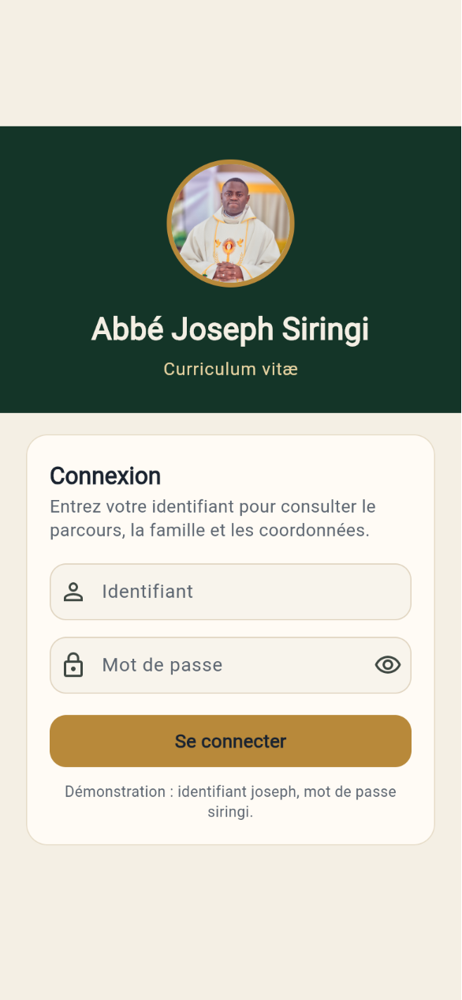
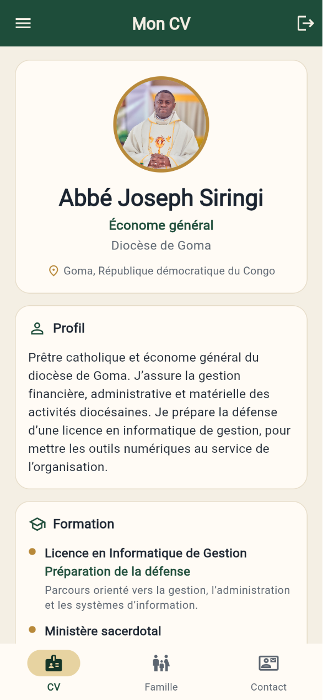
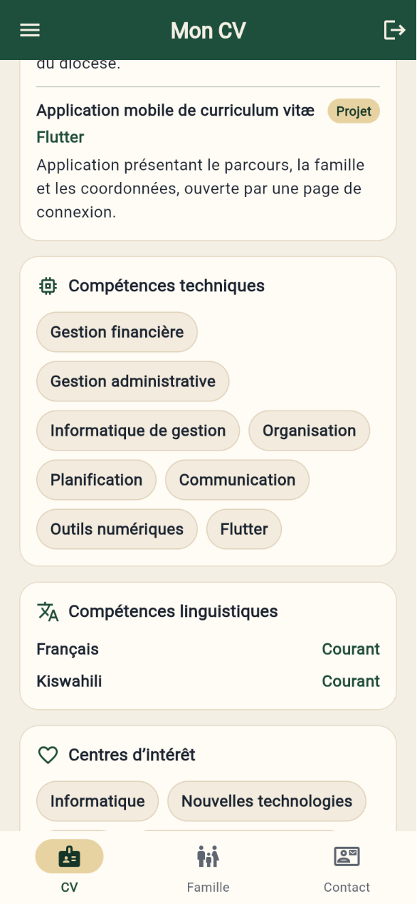
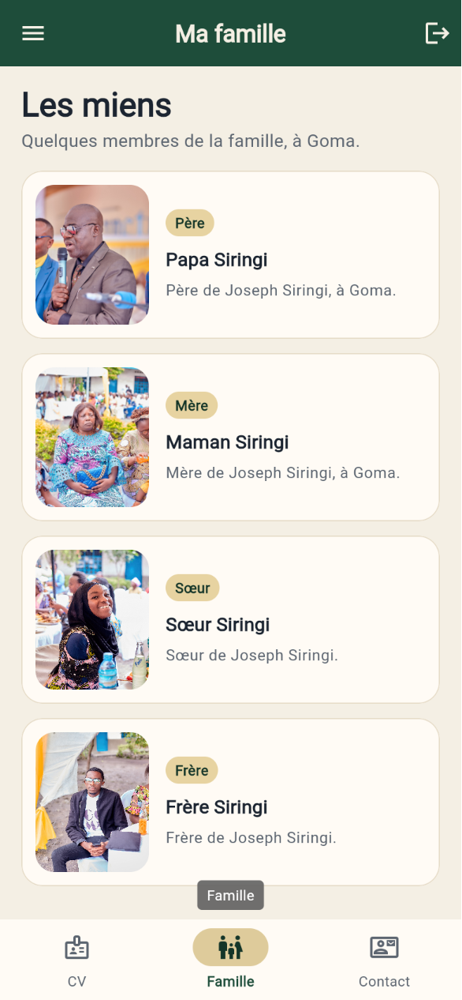
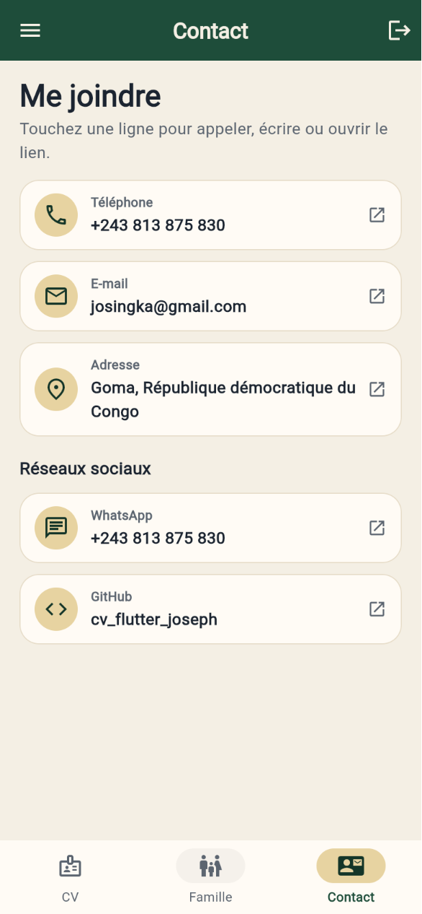

# cv_flutter_joseph

Application mobile Flutter qui présente le curriculum vitæ, la famille et les coordonnées de l’abbé Joseph Siringi, économe général du diocèse de Goma.

L’application s’ouvre sur une page de connexion. Une fois entré, on circule entre les pages avec la barre du bas ou le menu latéral.

## Connexion de démonstration

N’importe quel identifiant et mot de passe non vides ouvrent l’application.

- Identifiant : `joseph`
- Mot de passe : `siringi`

## Lancer le projet

```sh
flutter pub get
flutter run
```

## Captures d’écran

### Page de connexion



### Page d’accueil — curriculum vitæ





### Page famille



### Page contact



## Navigation

- Barre du bas : CV, Famille, Contact
- Menu latéral : les mêmes pages et la déconnexion
- Sur la page Contact, chaque ligne lance un appel, un e-mail, la carte, WhatsApp ou GitHub
